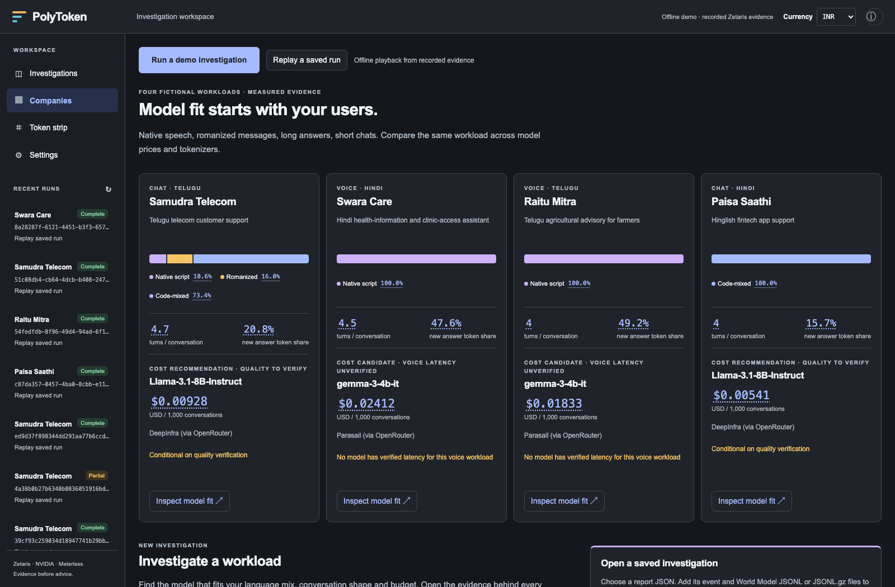

# PolyToken

**Which model fits your Indian-language users and your budget—and why?** PolyToken profiles the team's own conversations, measures their token counts, compares verified model/provider quotes, and explains a conditional recommendation with evidence you can inspect.

Built by **Mohan Chelluru** for Open Agent Hackathon 2026, **Track 02: The Agent That Can Explain Why**. All four companies and their forty conversations each are fictional. Translations and native review remain pending.



## The users change the fit

A voice agent usually receives native script from speech recognition. An app can receive romanized Telugu, Tenglish or Hinglish, with English product names and numbers. That mixture, conversation history and answer length change the bill.

The pre-existing Experiment 01 measured eighteen parallel sentences. Telugu / English token ratios were:

| Written as | Llama 3.2 | Gemma 3 |
| --- | ---: | ---: |
| Telugu script | 7.59× | 1.58× |
| Romanized | 1.68× | 1.57× |
| Tenglish | 1.09× | 1.06× |

For Hindi, the corresponding Llama / Gemma ratios were 2.44× / 1.18× in Devanagari, 1.87× / 1.59× romanized, and 1.21× / 1.04× code-mixed. These are token ratios on that reference corpus, not quality, latency or current-company measurements. [Raw counts](logs/sample/experiment01/fertility.csv) · [Original results](logs/sample/experiment01/fertility.md) · [Provenance](logs/sample/experiment01_provenance.jsonl).

## Four fresh live investigations

| Company / channel | Actual user mix | Cheapest cost candidate | USD / 1,000 conversations | Decision |
| --- | --- | --- | ---: | --- |
| Samudra Telecom / chat | 10.6% native, 16.0% romanized, 73.4% mixed | Llama-3.1-8B-Instruct | $0.009283 | Conditional on quality verification |
| Swara Care / voice | 100.0% native | gemma-3-4b-it | $0.024124 | Latency unverified; no qualified voice recommendation |
| Raitu Mitra / voice | 100.0% native | gemma-3-4b-it | $0.018329 | Latency unverified; no qualified voice recommendation |
| Paisa Saathi / chat | 100.0% mixed | Llama-3.1-8B-Instruct | $0.005411 | Conditional on quality verification |

These dated provider scenarios reconstruct completed conversations with each model's own tokenizer and price, including history replay. They exclude provider chat templates, retries, taxes and unpublished cache discounts; the small totals are content-token estimates, not invoices. USD prices retain their original fetch dates. All eight tokenizers completed on all four workloads. Eight priced models are ranked separately, with all eleven provider quotes available for inspection; four unpriced families show **tokenizer fit only**.

The predictions registered in the [25 October addendum](docs/CONTRACT.md) passed for each company's dominant script, cost candidate and constraint handling. Quality remains **verify on your sample**. Neither voice candidate has exact-model/provider/workload latency evidence, so neither receives a voice-qualified recommendation. [Recomputed score and top-three rankings](logs/sample/model_fit_score.md) · [Machine-readable score](logs/sample/model_fit_score.jsonl) · [Full completion report](docs/MODEL_FIT_COMPLETION.md).

The Model fit tab shows the script mix, conversation shape, answer share, ranked models, runner-up, and a higher-cost model to avoid on cost alone. Every figure opens a source receipt. The Companies view makes the different recommendations visible together. [Replay recording](docs/images/model_fit_replay.webm).

## How the evidence becomes advice

**Zetaris is the data layer.** Configuration, chats, measurements, reference sentences and prices are read through SQL. Public projections handle this connector's single-schema restriction; the price table uses a locally served REST source. PostgreSQL access is confined to setup and measurement writes. [Federation query](sql/token_ratio_by_part.sql) · [New federation evidence](logs/sample/model_fit_measurements/federation.jsonl) · [Live SQL audit](logs/sample/model_fit_v1_audit_zetaris_queries.jsonl).

**NVIDIA Nemotron is the brain.** One injected generator handles planning and contextual judging; model name, base URL and rate limit come from `.env`. The loop uses physical-attempt budgets, bounded retries and one shared limiter. Only GPT-OSS passed the recorded serving probe. The retained A/A-controlled protocol can test an answer-length hypothesis on that stand-in, but cannot establish quality or latency for a different model/provider. Fresh model-fit runs collect reasoning and service-call timings; they do not pretend to be new quality experiments. [Generator](src/polytoken/llm.py) · [Serving evidence](logs/sample/hosted_probe.jsonl) · [Fresh calls](logs/sample/model_fit_v1_audit_llm_calls.jsonl).

**Meterless reference architectures are implemented here.** World Model stores observations with source, query, time window and fetch time. H-MEM retains sourced company profiles and historical findings; replaced datasets do not inherit old findings. Markovian carries compressed state across bounded chunks and records projected versus actual token accounting. Its savings are a history-replay counterfactual, not a measured second execution. [Attribution and conformance](docs/METERLESS.md) · [New chunk accounting](logs/sample/model_fit_v1_audit_agent_markovian.jsonl).

**The deterministic checker gates every reported number.** It authenticates evidence and recomputes profiles, token ratios and per-model costs. Recommendations are rebuilt from those checked claims on replay. Missing prices never become zero cost; missing or mismatched timing never satisfies a voice constraint. [Calculator](src/polytoken/model_fit.py) · [Checker](src/polytoken/checker.py) · [Checker audit](logs/sample/model_fit_v1_audit_checker.jsonl).

## Run it

Python 3.10+, Git and the pinned `indictax` dependency are required. For live investigations, configure the local Zetaris stack, PostgreSQL demo source, and NVIDIA account. Node/Playwright are browser-test tools, not application dependencies. Run from the repository root.

```sh
uv venv .venv
source .venv/bin/activate
uv pip install '.[dev]'
cp .env.example .env
```

Fill the variable names in `.env.example` locally; never commit credentials. The harness is imported from the pinned public Git dependency, with an optional editable development override. [Declarations](docs/DECLARATIONS.md).

For the saved, offline demo:

```sh
polytoken serve --demo
```

Open [PolyToken](http://127.0.0.1:8000). All four replays include fresh recorded call timings. Older archives explicitly say “Timing unavailable” where no spans were captured.

For live setup, start the sponsor's Zetaris distribution and run its `./verify.sh`, then:

```sh
docker compose --env-file .env -f infra/docker-compose.yml up -d --wait
python scripts/seed_company_db.py
python scripts/serve_reference.py  # keep running in a separate terminal
python scripts/register_zetaris_sources.py
polytoken measure --company all
polytoken doctor
polytoken serve
```

```sh
polytoken investigate --company raitu --sample-suffix model_fit
# Optional, separately bounded controlled stand-in experiment:
polytoken investigate --company swara --test-answer-length --sample-suffix quality_sample
python -m pytest -q
python -m pytest -q -m live
polytoken score
```

## Limits and history

Script detection is a Unicode/lexicon heuristic with an unclassified bucket; English-term share means recognized domain terms. The data is synthetic and template-based, and translations remain unreviewed. Shared tokenizer families imply neither equal model quality nor equal latency. Observed latency samples are not SLAs. No unpublished cache discount or generated-answer improvement is invented.

All audit and provenance records go to `logs/`, with curated evidence committed in [logs/sample](logs/sample/). [Complete model-fit evidence closure](logs/sample/model_fit_v1_world_events.jsonl.gz) includes the first partial run as well as all four completed runs. Previous datasets and logs remain archived. Model-fit scoring is offline; the agent never reads the contract or scorer.

Cursor was not used. Codex and Claude assisted development. [Submission](docs/SUBMISSION.md) · [Metadata](metadata.json) · [MIT licence](LICENSE) · [Deck text](docs/DECK_TEXT.md). The submission video URL remains empty until a public upload is available.
