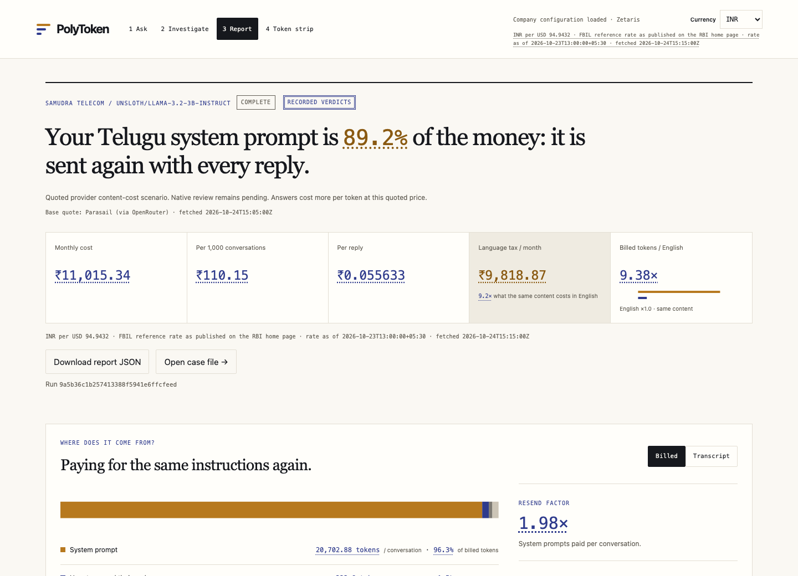
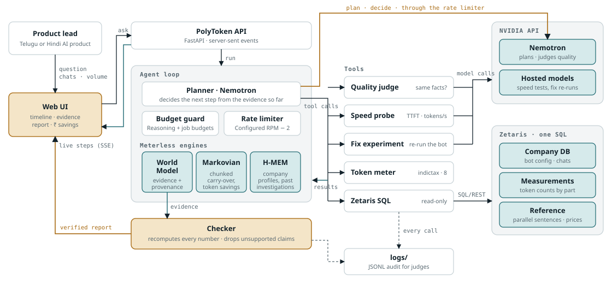

# PolyToken

**Understand the bill. Keep the meaning.** PolyToken investigates why a team's Telugu or Hindi AI workload costs more than the same content in English, traces the extra tokens to their source, and tests a fix before recommending it. The motivating, pre-existing experiment counted **18 parallel sentences**: Telugu used **7.59×** English tokens on Llama 3.2 and **1.58×** on Gemma 3. Those are token ratios, not measured latency or quality improvements. [Original results](logs/sample/experiment01/fertility.md) · [Raw counts](logs/sample/experiment01/fertility.csv) · [Provenance and recomputation](logs/sample/experiment01_provenance.jsonl).

Built by **Mohan Chelluru**, solo, for **Track 02 — The Agent That Can Explain Why**. The companies, policies and customer chats in this demo are fictional. Native translation and quality reviews remain pending.



## Who it is for

Product and engineering teams operating Indian-language support bots or voice assistants. The Token Ledger answers five practical questions:

1. What do we pay per month, conversation and reply?
2. What do we pay above the same content in English?
3. How much comes from prompts and history sent again?
4. Which fix saves money while preserving meaning, and what happens to reply time?
5. What changes with volume, quoted price or model?

The separate [pre-registered contract](docs/CONTRACT.md) groups these into four research questions. `polytoken score` evaluates the results offline; the agent never imports that evaluator or reads the planted expectations.

## What happened

| Fictional company | Finding reached by the agent | Tested change | Monthly quoted content cost, before → after | Quality and decision |
| --- | --- | --- | --- | --- |
| Samudra Telecom, Telugu support | Repeated system instructions dominate the money | English instructions; Telugu replies retained | **₹11,015.34 → ₹2,229.74** at **100,000 chats/month** | A/A **7/20**; A/B **3/20**; **inconclusive**, no recommendation |
| Swara Care, Hindi voice assistant | New answer tokens dominate cost | Concise spoken answers / answer cap | **₹2,386.55 → ₹2,447.46** at its configured volume | A/A **3/20**; A/B **1/20**; **inconclusive**, no recommendation |

Every table number comes from the checked [Samudra demo report](logs/sample/demo_samudra_report.json), [Swara v3 report](logs/sample/agent_swara_v3_report.json) and [contextual experiment summary](logs/sample/agent_v3_completion_report.md). Rupees use the dated [FX source](data/reference/fx.json); model prices have their own [provider URLs and fetch dates](data/reference/prices.json). These are content-only quoted scenarios, not invoices.

The Samudra prompt substitution reduces reconstructed cost by **79.8%**, with historical replies and replay held fixed. That does **not** establish that the changed bot preserves meaning. The unchanged A/A control itself falls below the contract's **18/20** bar, so the interpretation is: **“the bar cannot be met by this judge and stand-in model; result inconclusive.”** The literal A/B contract verdict remains failed. [Checked cost and quality evidence](logs/sample/demo_samudra_report.json) · [Contract and diagnostics](logs/sample/contract_score.md).

Samudra's timing is inconclusive because the run reuses cached timing evidence with its original time windows. Swara's changed stand-in reply was faster in the recorded trials: median complete-reply time **13.24 s → 2.09 s**. This is an original-versus-changed prompt comparison, not a deployed-model Telugu/Hindi-versus-English speed benchmark. Output throughput is unavailable when provider usage cannot separate hidden reasoning. [Timing observations and limits](logs/sample/agent_v3_completion_report.md).

Both expected top findings pass the offline contract check. Cost coverage, speed coverage and validated fixes remain partial; neither expected fix is recommended. [Full score, claim IDs and budgets](logs/sample/contract_score.md) · [Machine-readable score](logs/sample/contract_score.jsonl).

The new UI demo uses fresh Nemotron reasoning and Zetaris reads, then reuses authenticated prior generations and judgments under exact cache identities. It is not a fresh independent quality replication. [Demo events](logs/sample/demo_samudra.jsonl) · [Physical calls](logs/sample/demo_samudra_audit_llm_calls.jsonl) · [Cache audit](logs/sample/demo_samudra_audit_experiment_jobs.jsonl). [Native Telugu review sheet](logs/sample/native_review_samudra.md); a Hindi reviewer is still required.

## How it works



The exported system diagram comes from the [architecture reference](docs/design/reference/architecture.html). The investigation proceeds through clarify, measure, locate, hypothesise, experiment, judge, speed, check and report. Long generation and judging work runs as a bounded background job; the UI streams its events and displays the final checked report. [Implementation](src/polytoken/agent/runner.py) · [Report contract](docs/REPORT_SCHEMA.md).

The [deterministic checker](src/polytoken/checker.py) authenticates content-addressed evidence and its supporting records, then recomputes every reported number from source rows. Unsupported or inconsistent claims are dropped. The [billing projection](src/polytoken/billing_view.py) independently reconstructs native and English bills, supplies clickable receipts, and separates observed results from explicit price/volume what-ifs. [Billing formulas](web/BILLING_SCHEMA.md). Arithmetic and quote validation cannot establish that a model's semantic judgment is correct.

### Zetaris

Zetaris is the data layer for all investigation reads: company configuration and chats, measured tokens, reference sentences, and a locally served REST price source. The [federation SQL](sql/token_ratio_by_part.sql) joins across those sources; [saved SQL results](logs/sample/p04_federation.jsonl) demonstrate the query. Direct PostgreSQL access is confined to seeding and measurement writes. [Client](src/polytoken/zetaris.py) · [Tool layer](src/polytoken/tools/__init__.py).

The installed JDBC connector exposes one schema per source. [Registration](scripts/register_zetaris_sources.py) uses explicit public views over the company, measurement and reference schemas. [Reference serving](src/polytoken/reference_server.py) refreshes the REST table when its earlier empty-price schema lacks current columns. This workaround is recorded, not a silent switch to local price reads. [Registration decisions](docs/DECISIONS.md) · [SQL audit](logs/sample/demo_samudra_audit_zetaris_queries.jsonl).

### Meterless

PolyToken independently implements the reference architectures in Python, with **29 ported conformance checks**, rather than presenting them as a hosted service. [Attribution, pinned specification and check IDs](docs/METERLESS.md).

- [World Model](src/polytoken/meterless/world_model.py): observations and claims carry source, query, time window and fetch time; evidence remains replayable.
- [H-MEM](src/polytoken/meterless/hmem.py): sourced company profiles and prior findings persist across investigations, with an audited trust ledger.
- [Markovian](src/polytoken/meterless/markovian.py): bounded reasoning chunks compress carried state; projected and actual token accounting remain distinct. Signed savings expose cases where compression costs extra tokens. [Signed audit](logs/sample/meterless_signed_audit.jsonl).

The history-replay comparison is a reference counterfactual, not an independently measured second agent run. [Scope and limitations](docs/METERLESS.md).

### NVIDIA

Nemotron plans the investigation and judges contextual reply pairs through **one injected generator**, configured by `.env`. [Generator](src/polytoken/llm.py) · [Composition root](src/polytoken/agent/runtime.py) · [Quality protocol](src/polytoken/agent/quality.py). Calls use a shared rate limiter, bounded retries and separate reasoning/judge/hosted budgets. [Contract limits](docs/CONTRACT.md) · [Measured budget score](logs/sample/contract_score.md).

Hosted models generate paired experiments and speed trials. Catalogue membership alone is insufficient: eligibility also requires a recorded serving probe. Successful and failed probes are preserved in [probe results](logs/sample/hosted_probe.jsonl), with the [verified allowlist](data/reference/nvidia_hosted.json). The demonstrated GPT-OSS model is a stand-in, not either company's deployed model. Model names, base URL and rate limit come from configuration; the planner is not hardcoded to a deployment name.

### Cursor

Cursor was not used in this project. Coding assistance came from Codex and Claude, as declared in [DECLARATIONS.md](docs/DECLARATIONS.md).

## Honest limits

The data is synthetic, some answer openings are template-like, and translations have not passed native review. The unchanged control can vary even at temperature zero. Claim-level judging can mark added details as non-equivalent without establishing that the new answer is worse. Source-excerpt validation catches invented citations, not incorrect semantic classification. [Quality protocol, recovery history and limitations](logs/sample/agent_v3_completion_report.md).

The configured Samudra model is a low-priced **3B** model, so a large percentage saving produces modest absolute money. The UI can rescale checked input and output counts at explicit hypothetical prices and volume; it does not predict quality or latency at those prices. Content accounting excludes provider chat templates, retries and unpublished cache discounts. [Independent review](docs/review/2026-10-24/REVIEW.md) · [Accounting formulas](web/BILLING_SCHEMA.md).

## Run it

Prerequisites: Python 3.10+, `uv`, Git, Docker, the hackathon Zetaris distribution, a configured NVIDIA account, and local Hugging Face tokenizer files (or network access for initial measurement). Node and Playwright are optional for the browser tests, not application dependencies. Run from the cloned repository root, including after a non-editable installation: the UI and reviewed reference data live in the checkout.

```sh
uv venv .venv
source .venv/bin/activate
uv pip install '.[dev]'
cp .env.example .env
export HF_HOME="$PWD/.cache/huggingface"
```

Fill `.env` locally. Names only: `NVIDIA_API_KEY`, `NVIDIA_BASE_URL`, `AGENT_MODEL`, `NVIDIA_RPM`, `HF_TOKEN`, `ZETARIS_URL`, `ZETARIS_USER`, `ZETARIS_PASSWORD`, `COMPANY_DB_USER`, `COMPANY_DB_PASSWORD`. Use an accessible Nemotron model for `AGENT_MODEL`. Never commit `.env`. [Validated settings](src/polytoken/config.py).

Start the sponsor's Zetaris stack using its supplied instructions, then run `./verify.sh` in that distribution (locally, `~/zetaris-platform`). Back in PolyToken:

```sh
docker compose --env-file .env -f infra/docker-compose.yml up -d --wait
python scripts/seed_company_db.py
# Separate terminal; keep the REST price source running:
python scripts/serve_reference.py
# Back in the first terminal:
python scripts/register_zetaris_sources.py
polytoken measure --company all
polytoken doctor
polytoken serve
```

Open [the local UI](http://127.0.0.1:8000), select a fictional company and click **Investigate**. `serve` reuses or starts the price endpoint and checks its registration. The client reads the returned Zetaris organization ID rather than assuming one. Existing archived reports can be opened without rerunning model calls.

```sh
python -m pytest -q                  # offline; live checks skipped
python -m pytest -q -m live          # explicitly contacts configured services
polytoken score                     # offline contract evaluation
UI_SCREENSHOTS=1 python -m pytest -q tests/test_ui_static.py
```

The harness is installed from its pinned public Git dependency. A sibling checkout is unnecessary. [Pin and pre-existing work](docs/DECLARATIONS.md) · [Browser-test setup](web/README.md) · [Shipping validation](logs/sample/ship_completion_report.md).

## Evidence and submission

All audit and provenance records go to `logs/`; curated judge-facing samples are committed under [`logs/sample/`](logs/sample/). The live demo's new World Model archive is [gzip-compressed](logs/sample/demo_samudra_world_events.jsonl.gz) and includes the transitive evidence closure, including reused observations. The offline scorer and billing loader read compressed archives directly.

The reviewer accepted these existing evidence files above the release size threshold; their bytes and Git history are preserved:

| Existing archive | Bytes | Decimal MB |
| --- | ---: | ---: |
| [Original agent evidence](logs/sample/agent_world_events.jsonl) | 15,921,942 | 15.92 |
| [v2 evidence](logs/sample/agent_v2_world_events.jsonl) | 15,536,266 | 15.54 |
| [v3 evidence](logs/sample/agent_v3_world_events.jsonl) | 40,470,818 | 40.47 |

[Size and history audit](logs/sample/ship_secret_scan.jsonl). New archives exceeding 5 MB are gzipped. `.cache/`, `.venv/` and runtime logs outside the curated sample directory remain ignored.

[Submission explanation and summary](docs/SUBMISSION.md) · [Metadata](metadata.json) · [MIT licence](LICENSE) · [Declarations](docs/DECLARATIONS.md) · [Independent review](docs/review/2026-10-24/REVIEW.md). The demo video URL is intentionally empty for Mohan to fill. Repository publication is Mohan's step.
